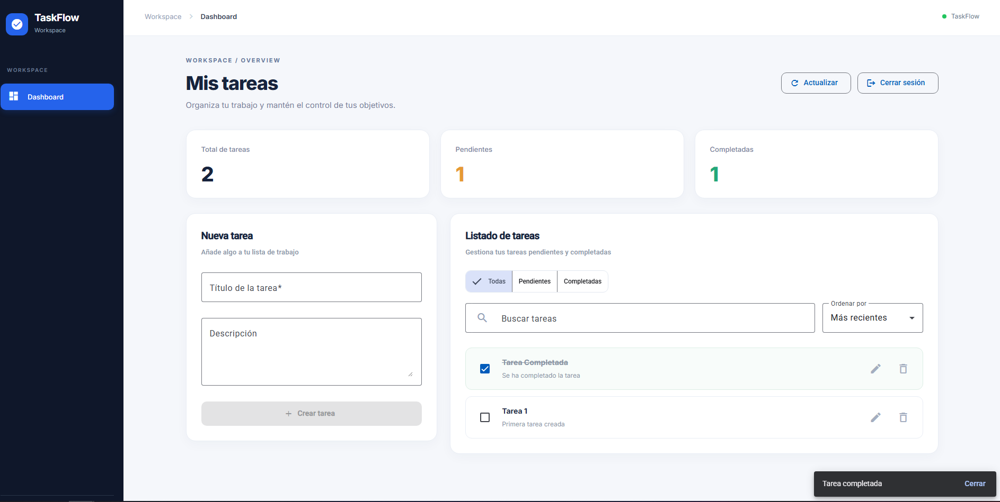
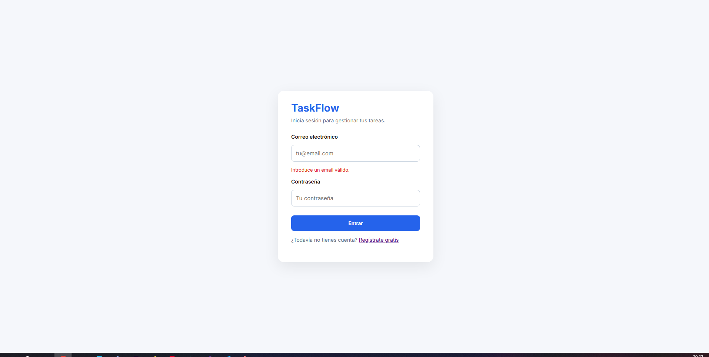
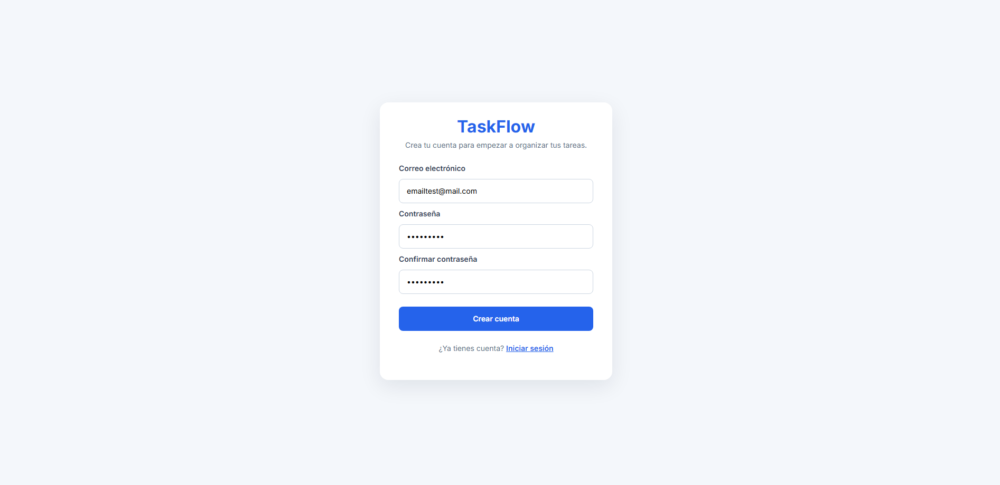

# TaskFlow

**Full Stack Task Management Application | Angular 21 · ASP.NET Core 10 · PostgreSQL**

TaskFlow is a full-stack web application designed to manage personal tasks through a responsive interface, a REST API and a persistent PostgreSQL database.

The project demonstrates end-to-end application development, including frontend architecture, backend services, authentication, database persistence, automated testing and cloud deployment.

**Live application:** https://taskflow-azh.pages.dev

**Source code:** https://github.com/EsanclemDev/taskflow

## Features

## Application Screenshots

### Task Management Dashboard



### Authentication

| Login | Registration |
|---|---|
|  |  |

### Empty Dashboard


### Task management
- Create, view, update and delete tasks.
- Mark tasks as completed or pending.
- Search tasks by title or description.
- Filter tasks by completion status.
- Sort tasks by date or title.
- View reactive dashboard statistics.
- Edit tasks using modal dialogs.
- Receive confirmation messages and notifications.

### Authentication and security
- User registration and login.
- Authentication with ASP.NET Core Identity.
- Bearer access tokens and refresh token management.
- Server-side session revocation.
- Logout synchronization across browser tabs.
- User-specific task ownership.
- Password validation and account lockout policies.
- Persistent Data Protection keys.

### User experience
- Responsive Angular Material interface.
- Reactive state management with Angular Signals and RxJS.
- Separate authentication and application layouts.
- Form validation and user feedback.

## Technology Stack

| Layer | Technologies |
|---|---|
| Frontend | Angular 21, TypeScript, Angular Material, SCSS |
| State management | Angular Signals, RxJS |
| Backend | ASP.NET Core Web API, C#, .NET 10 |
| Authentication | ASP.NET Core Identity, Bearer Tokens |
| Persistence | Entity Framework Core, Npgsql |
| Database | PostgreSQL 17 (local), Neon (production) |
| Testing | xUnit, backend integration tests, PostgreSQL |
| Infrastructure | Docker, Docker Compose |
| CI/CD | GitHub Actions, Cloudflare Pages, Render |
| API documentation | Swagger / OpenAPI (development) |

## Architecture

```text
                Angular 21
             Frontend Application
                      |
                      | HTTPS / REST
                      v
              ASP.NET Core 10
                   Web API
                      |
             Authentication
              Authorization
             Business Services
                      |
                      v
              Entity Framework
                    Core
                      |
                      v
                 PostgreSQL
```

The application separates presentation, API endpoints, business services and database persistence.

Authentication is based on ASP.NET Core Identity bearer tokens. The project does not use JWT access tokens.

## Environments

| Environment | Frontend | Backend |
|---|---|---|
| Local | localhost:4200 | localhost:7000 (HTTPS) |
| Beta | Angular beta configuration | Beta Render deployment |
| Production | Cloudflare Pages | Render |

The production PostgreSQL database is hosted on Neon.

Angular uses environment-specific configurations for development, beta and production builds.

## Getting Started

### Prerequisites

- Node.js and npm
- .NET 10 SDK
- Docker Desktop with Docker Compose
- Git

### Clone the repository

```bash
git clone https://github.com/EsanclemDev/taskflow.git
cd taskflow
```

### Start PostgreSQL

Create a `.env` file in the project root, using `.env.example` as a template.

Configure the following variables:

```dotenv
POSTGRES_DB=taskmanager
POSTGRES_USER=devuser
POSTGRES_PASSWORD=your_local_password
```

Start the database:

```bash
docker compose up -d
```

### Configure and start the backend

Set the `ConnectionStrings__DefaultConnection` environment variable to match your local PostgreSQL configuration.

For example:

```text
Host=localhost;Port=5432;Database=taskmanager;Username=devuser;Password=your_local_password
```

Navigate to the backend:

```bash
cd backend/TaskManager.Api
```

Apply Entity Framework Core migrations:

```bash
dotnet ef database update
```

Run the API using its configured HTTPS launch profile:

```bash
dotnet run --launch-profile https
```

The frontend development configuration expects the API at:

```text
https://localhost:7292/api
```

If the backend uses a different port, update the Angular development environment configuration.

### Start the frontend

Open another terminal:

```bash
cd frontend/task-manager-ui
npm install
npm start
```

Open:

http://localhost:4200

## Automated Testing

The backend includes automated tests covering authentication, session management and refresh token behavior.

Run the backend tests:

```bash
dotnet test backend/TaskManager.Api.Tests/TaskManager.Api.Tests.csproj
```

Some tests require a dedicated local PostgreSQL test database.

GitHub Actions runs backend tests with an isolated PostgreSQL service, without accessing the production Neon database.

## Deployment

TaskFlow uses separate frontend and backend deployments.

**Frontend:** Cloudflare Pages

**Backend:** Render

**Production database:** Neon PostgreSQL

The backend reads its database connection from the `ConnectionStrings__DefaultConnection` configuration key.

Production secrets must be configured through the hosting provider and must never be committed to the repository.

## API

The backend exposes REST endpoints for task management and authentication.

Task operations are protected by authentication and authorization.

Swagger UI is available when the backend runs in the Development environment.

## Project Documentation

Additional technical documentation is organized under the `docs/` directory:

- `docs/architecture.md` — System architecture and application components.
- `docs/authentication.md` — Authentication, refresh tokens and session revocation.
- `docs/deployment.md` — Environment configuration and deployment.
- `docs/screenshots/` — Application screenshots.

## Roadmap

**v0.2.0 — Authentication and production deployment**

- Identity-based authentication.
- Refresh token and session management.
- Multi-tab logout.
- Automated backend testing.
- Cloud deployment.

**Future releases**

- Further user experience improvements.
- Additional account management capabilities.
- Expanded automated testing.
- AI-assisted task organization.

## Author

**Enrique Sanclemente**

Full Stack Developer | Angular · .NET · C# · Java · PostgreSQL

GitHub: https://github.com/EsanclemDev