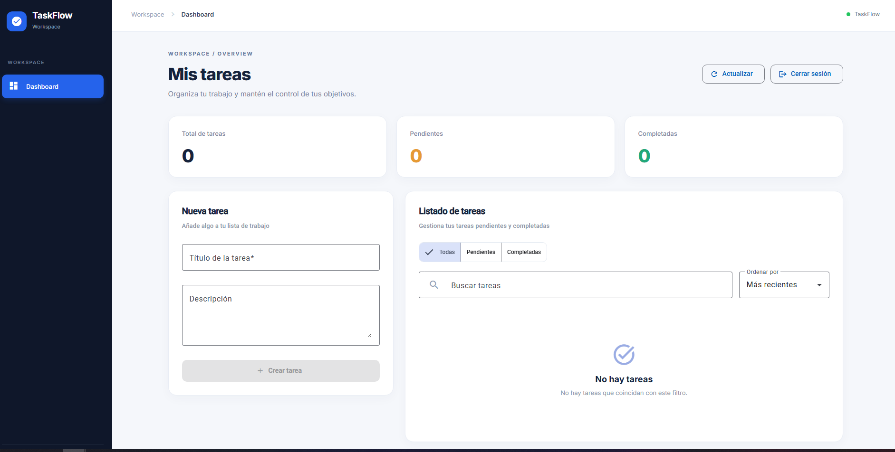

# TaskFlow

**Full Stack Task Management Application | Angular 21 · ASP.NET Core 10 · PostgreSQL**

TaskFlow is a full-stack task management application built with Angular, ASP.NET Core and PostgreSQL. It provides a responsive dashboard, a Kanban workflow, detailed task management, secure user sessions and an isolated demo mode.

The project showcases end-to-end software development: frontend architecture, REST API design, authentication and authorization, relational data modeling, automated integration tests, CI/CD and cloud deployment.

**Live production application:** https://taskflow-azh.pages.dev  
**Source code:** https://github.com/EsanclemDev/taskflow

> **Release status:** v0.3.0 is deployed to the `develop`/beta environment. The production application linked above may still be running v0.2.0 until v0.3.0 is promoted to `main` and verified.

## Features

### Dashboard and task management

- Dashboard with reactive task statistics and an overview of task progress.
- Create, view, update and delete personal tasks.
- Kanban board with drag-and-drop movement between **Pending**, **In Progress** and **Completed**.
- Task details including priority, category, optional due date, creator and assignee.
- Search tasks by title or description, filter by status and sort tasks.
- Edit tasks through an Angular Material interface with validation, dialogs and feedback messages.
- Per-user task isolation enforced by the backend.

### Demo mode (v0.3.0)

- Explore TaskFlow without creating a permanent account.
- Each demo visitor receives an isolated demo user with **12 sample tasks**.
- Reset demo tasks to their initial state.
- Demo accounts expire after **24 hours**, with cleanup of expired accounts.
- Rate limiting protects demo account creation from excessive requests.

### Authentication and security

- Registration, login and current-user endpoints built with ASP.NET Core Identity.
- **Opaque bearer access tokens (not JWTs)** and refresh-token-based session renewal.
- Refresh-token rotation, session-family revocation and server-side active-session validation.
- Logout synchronization across browser tabs.
- Secure, HttpOnly refresh cookies, origin validation and password/account lockout policies.
- Persistent ASP.NET Core Data Protection keys.
- Ownership checks for all task operations; demo data remains isolated from registered users.

### User experience

- Responsive Angular Material interface with separate authentication and application layouts.
- Angular Signals and RxJS for reactive application state.
- Kanban interactions, task dialogs, form validation and user notifications.

## Application Screenshots

> The screenshots below are retained from the existing documentation. Update or add images from the v0.3.0 beta interface before the production release, especially for the Kanban board and demo mode.

### Task Management Dashboard


### Authentication

| Login | Registration |
| --- | --- |
|  |  |

### Empty Dashboard



## Technology Stack

| Layer | Technologies |
| --- | --- |
| Frontend | Angular 21, TypeScript, Angular Material, SCSS |
| State management | Angular Signals, RxJS |
| Backend | ASP.NET Core Web API, C#, .NET 10 |
| Authentication | ASP.NET Core Identity, opaque bearer tokens, refresh sessions |
| Persistence | Entity Framework Core, Npgsql |
| Database | PostgreSQL 17 (local), Neon PostgreSQL (beta and production branches) |
| Testing | xUnit, API integration tests, PostgreSQL integration tests |
| Infrastructure | Docker, Docker Compose |
| CI/CD | GitHub Actions, Cloudflare Pages, Render |
| API documentation | Swagger / OpenAPI (development) |

## Architecture

```text
                      Angular 21
               Angular Material UI
             Dashboard / Kanban / Demo
                           |
                    HTTPS / REST
                           |
                  Cloudflare Pages
             (beta: /api Pages Function)
                           |
                   ASP.NET Core 10
                        Web API
                           |
          +----------------+----------------+
          |                |                |
    Authentication    Task management    Demo accounts
    and sessions      and ownership      and reset
          |                |                |
          +----------------+----------------+
                           |
                  Entity Framework Core
                           |
                    PostgreSQL / Neon
```

The frontend, API, business logic and persistence are separate concerns. Task endpoints require authentication and enforce ownership using the current user. ASP.NET Core Identity bearer tokens are **not JWTs**.

The beta frontend calls `/api` on its own origin. A Cloudflare Pages Function at `frontend/task-manager-ui/functions/api/[[path]].js` forwards these requests to the configured backend. The Function reads the **`API_ORIGIN`** environment variable, which must be an HTTPS origin without an `/api` path.

## Environments

| Environment | Frontend API setting | Backend | Database |
| --- | --- | --- | --- |
| Local | `https://localhost:7292/api` | Local .NET HTTPS launch profile | Docker PostgreSQL |
| Beta (`develop`) | `/api` through Cloudflare Pages Function | Beta Render service | Neon `develop` branch |
| Production (`main`) | Production API URL | Production Render service | Neon production branch |

Angular build configurations use `fileReplacements` for `development`, `beta` and `production`. The beta build must explicitly use `--configuration beta`; the default build configuration is production.

Do not use production credentials or the production database for local development, beta deployments or CI tests.

## Getting Started

### Prerequisites

- Node.js and npm
- .NET 10 SDK and EF Core CLI (`dotnet ef`)
- Docker Desktop with Docker Compose
- Git

### Clone the repository

```bash
git clone https://github.com/EsanclemDev/taskflow.git
cd taskflow
```

### Start PostgreSQL

Create a `.env` file in the repository root using `.env.example` as a template. Use local-only credentials:

```dotenv
POSTGRES_DB=taskmanager
POSTGRES_USER=devuser
POSTGRES_PASSWORD=your_local_password
```

Start the database:

```bash
docker compose up -d
```

### Configure and start the backend

Configure `ConnectionStrings__DefaultConnection` in your local environment (or a local, untracked configuration source) with an Npgsql connection string matching Docker:

```text
Host=localhost;Port=5432;Database=taskmanager;Username=devuser;Password=your_local_password
```

From the repository root, apply EF Core migrations and run the API:

```bash
dotnet ef database update --project backend/TaskManager.Api --startup-project backend/TaskManager.Api
dotnet run --project backend/TaskManager.Api --launch-profile https
```

The checked-in Angular development environment points to `https://localhost:7292/api`. Trust the local .NET development certificate if your browser reports a certificate warning.

### Start the frontend

In a second terminal, from the repository root:

```bash
cd frontend/task-manager-ui
npm ci
npm start
```

Open http://localhost:4200.

## Automated Testing

The backend includes **61 automated tests** covering task APIs, authentication, session management, refresh-token rotation and PostgreSQL-dependent behavior.

Run the tests from the repository root:

```bash
dotnet test backend/TaskManager.Api.Tests/TaskManager.Api.Tests.csproj
```

Some tests require a dedicated PostgreSQL instance configured through `TASKFLOW_TEST_POSTGRES`. Use a disposable local test database; **never** point tests at Neon production or the Neon beta branch.

GitHub Actions runs the backend tests on .NET 10 with an isolated PostgreSQL 16 service. The v0.3.0 workflow passed on `develop`.

## Database Migrations (v0.3.0)

The v0.3.0 schema changes are:

```text
20261118133802_AddTaskWorkflowStatus
20261118142635_AddTaskCreatorAndAssignee
20261118145240_AddTaskDetails
20261118163122_AddDemoUsers
```

These migrations have been applied to the **Neon `develop` branch**. Production migrations must be applied separately, after confirming the target connection and creating an appropriate backup or restore point.

## Deployment

- **Frontend:** Cloudflare Pages
- **Backend:** Render
- **Database:** Neon PostgreSQL, with separate beta and production branches
- **CI:** GitHub Actions

The backend reads its database connection from `ConnectionStrings__DefaultConnection` (environment variable `ConnectionStrings__DefaultConnection`). Keep credentials in hosting-provider secrets, not in the repository.

For the **beta** frontend, configure the Cloudflare Pages Function variable:

```text
API_ORIGIN=https://your-beta-backend.onrender.com
```

Use the actual beta Render origin. Do not append `/api` and do not use `API_HOST`: the checked-in Function reads `API_ORIGIN`. The beta frontend calls `/api` on the same origin and the Function proxies requests to Render.

To build the beta frontend explicitly:

```bash
cd frontend/task-manager-ui
npm run build -- --configuration beta
```

Verify the beta deployment, database migrations and functional smoke tests before promoting `develop` to `main`.

## API

| Method | Endpoint | Description |
| --- | --- | --- |
| `POST` | `/api/auth/register` | Register an account |
| `POST` | `/api/auth/login` | Log in and start a session |
| `GET` | `/api/auth/me` | Get the current user |
| `POST` | `/api/auth/refresh` | Renew the session |
| `POST` | `/api/auth/logout` | Revoke the session |
| `POST` | `/api/auth/demo` | Start an isolated demo session |
| `POST` | `/api/demo/reset` | Restore the current demo user's sample tasks |
| `GET` | `/api/tasks` | List the current user's tasks |
| `GET` | `/api/tasks/{id}` | Get a task |
| `POST` | `/api/tasks` | Create a task |
| `PUT` | `/api/tasks/{id}` | Update a task |
| `DELETE` | `/api/tasks/{id}` | Delete a task |

Task operations require authentication and enforce user ownership. Swagger UI is available when the backend runs in the `Development` environment.

## Project Documentation

Additional technical documentation is under `docs/`:

- `docs/architecture.md` — System architecture and application components.
- `docs/authentication.md` — Authentication, refresh tokens and session revocation.
- `docs/deployment.md` — Environment configuration and deployment.
- `docs/screenshots/` — Application screenshots.
- `CHANGELOG.md` — Version history and release changes.

> The detailed documents under `docs/` currently describe v0.2.0 and should be updated as part of the v0.3.0 documentation review.

## Roadmap

### v0.2.0 — Authentication and cloud deployment

- Identity-based registration and login.
- Refresh-token rotation, session revocation and multi-tab logout.
- Per-user task authorization.
- Backend integration testing and cloud deployment.

### v0.3.0 — Dashboard, Kanban and demo mode (beta)

- Reactive dashboard statistics.
- Three-stage Kanban workflow with drag-and-drop.
- Task priority, category, due date, creator and assignee.
- Isolated demo accounts with sample tasks and reset functionality.
- Updated database schema and beta deployment.

### v0.4.0 — Planned

- User profile and account management.
- Password recovery.

### Future

- Further usability and testing improvements.
- Post-v1.0 AI-assisted task organization: duplicate detection, missing-information checks, automatic classification and organizational suggestions.

## Author

**Enrique Sanclemente**  
Full Stack Developer | Angular · .NET · C# · Java · PostgreSQL

GitHub: https://github.com/EsanclemDev
